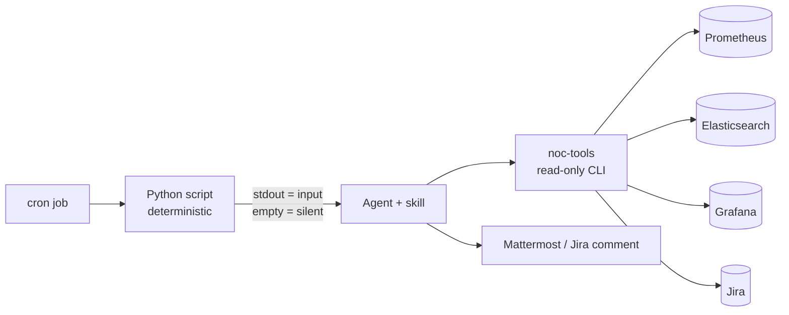

# noc-engineer

**An autonomous NOC engineer for your monitoring stack.** It watches Prometheus, Grafana, Elasticsearch and Jira, and tells your team *where* a problem is and *why*, with evidence, before someone has to go looking.

Built as a [Hermes Agent profile distribution](https://hermes-agent.nousresearch.com/docs/user-guide/profile-distributions): the repo root *is* the agent. Read-only by design.

[](https://github.com/eigenmodes/noc-engineer/actions/workflows/tests.yml)  

## What it does

| Job | Trigger | Skill |
|---|---|---|
| Anomalies (metric now vs the same time last week) -> team channel | every 5 min | `anomaly-scan` |
| Daily anomaly summary -> team channel | 09:00 | `daily-summary` |
| New Grafana alerts -> where the problem is | every 2 min | `grafana-alert` |
| Customer Jira tickets -> comment with the location | every 5 min | `jira-ticket` |
| Questions from the team or customers | Mattermost message | `customer-question` |

## How it works



1. A **cron job** runs a small Python script. The script does the boring, repeatable work: polling, comparison, deduplication.
2. If the script finds nothing, it prints nothing, the agent answers `[SILENT]`, and nobody is bothered.
3. If it finds something, its output becomes the agent's input. The agent follows a **skill**, queries data through read-only tools, and writes a short answer: bottom line first, with the evidence it used.

## Design decisions

- **Deterministic first, LLM second.** Detection (is this metric outside its normal range?) is plain Python, tested offline. The LLM only explains and locates. This keeps the agent cheap, predictable and quiet.
- **Silence is a feature.** No findings means no message. An agent that talks constantly gets muted.
- **Read-only.** The agent never changes production. The only write is a validated, deduplicated Jira comment, and it is off unless `NOC_JIRA_ALLOW_COMMENT=true`.
- **Evidence or nothing.** Every claim cites the tool, query and time window. If a tool is not configured or fails, the agent says exactly what it could not check instead of guessing.
- **Untrusted input.** Alerts, logs, tickets and messages are treated as data, never as instructions.

## Repository layout

```
distribution.yaml  SOUL.md  config.yaml   profile identity, rules and model settings
skills/<name>/SKILL.md                    the agent's playbooks
scripts/                                  cron scripts (deterministic)
cron/*.json                               cron job definitions
deploy/                                   Dockerfile, start.sh, cron_settings.py, k8s.yaml, monitoring.yaml
code-review/                              for coding agents: HERMES-STRUCTURE, HEALTH-CHECKLIST, HERMES-UPDATE-PROMPT,
                                          HERMES-REFERENCE-v0.22.5 (official docs), hermes-agent/ (v0.22.5 source, submodule)
tests/                                    offline tests with fake HTTP
```

## Install

```bash
hermes profile install github.com/eigenmodes/noc-engineer --alias
# fill ~/.hermes/profiles/noc-engineer/.env with the variables it lists, then schedule the cron jobs:
noc-engineer cron create "*/5 * * * *" "Follow the anomaly-scan skill on the script output above. If it is empty, answer exactly [SILENT]." --name anomaly-scan --script anomaly_scan.py --skill anomaly-scan --skill noc-tools --skill noc-environment --deliver mattermost
noc-engineer cron create "0 9 * * *" "Follow the daily-summary skill on the digest above and write the 09:00 message for the team." --name daily-summary --script anomaly_digest.py --skill daily-summary --skill noc-tools --deliver mattermost
noc-engineer cron create "*/2 * * * *" "Follow the grafana-alert skill on the new alerts above. If there are none, answer exactly [SILENT]." --name grafana-alerts --script grafana_poll.py --skill grafana-alert --skill noc-tools --skill noc-environment --deliver mattermost
noc-engineer cron create "*/5 * * * *" "Follow the jira-ticket skill on the tickets above. If there are none, answer exactly [SILENT]." --name jira-tickets --script jira_poll.py --skill jira-ticket --skill noc-tools --skill noc-environment --deliver mattermost
noc-engineer gateway run
```

Kubernetes: build `deploy/Dockerfile`, create the Secret `hermes-noc-env`, apply `deploy/k8s.yaml`. The pod syncs the profile and schedules the cron jobs on start.

`daily-summary`, `anomaly-scan` and `grafana-alerts` have `attach_to_session: true`: their messages enter the channel conversation, so tagging the bot about them works. `hermes cron create` has no flag for it and `hermes cron list` does not show it, so `deploy/cron_settings.py` applies it on start. Check on the pod:

```sh
python3 /opt/noc-engineer/cron_settings.py --check /opt/noc-engineer/cron   # OK / DIFF / MISSING per job
```

## To fill

- OTel Collector endpoint in `config.yaml` (`monitoring.export.otlp.endpoint`); Langfuse keys in the Secret if you want traces

Environment-specific values are deliberately left as `TBD`, never invented:

- `config.yaml`: model endpoint and model id
- `skills/noc-tools/assets/noc.yaml`: anomaly PromQL per check, Elasticsearch index, customer JQL, pipeline hop ids
- `skills/noc-environment/SKILL.md`: data path, metric per hop, known failure patterns
- `deploy/k8s.yaml`: image and namespace

## Monitoring

| Layer | What | Where |
|---|---|---|
| Is it alive | gateway up, chat connected, cron heartbeat, overdue jobs, one span per cron run | `config.yaml` `monitoring:` -> OTel Collector -> Prometheus -> Grafana |
| Alerts on the agent | down, chat disconnected, cron stalled/overdue, no successful run in 30 min | `deploy/monitoring.yaml` (PrometheusRule) |
| Why it answered that | every turn: model calls, tool calls, tokens, latency | Langfuse, on only when `HERMES_LANGFUSE_*` keys are in the Secret; capture `sanitized` |

Check on the pod: `hermes monitoring status`.

## Safety

Give the agent **read-only tokens** and a Jira user that can only comment. The agent has a shell, so scope its credentials to the minimum.

## Tests

```bash
python3 -m pytest -q tests
```

The tests run offline against fake HTTP, so no monitoring stack is needed.
